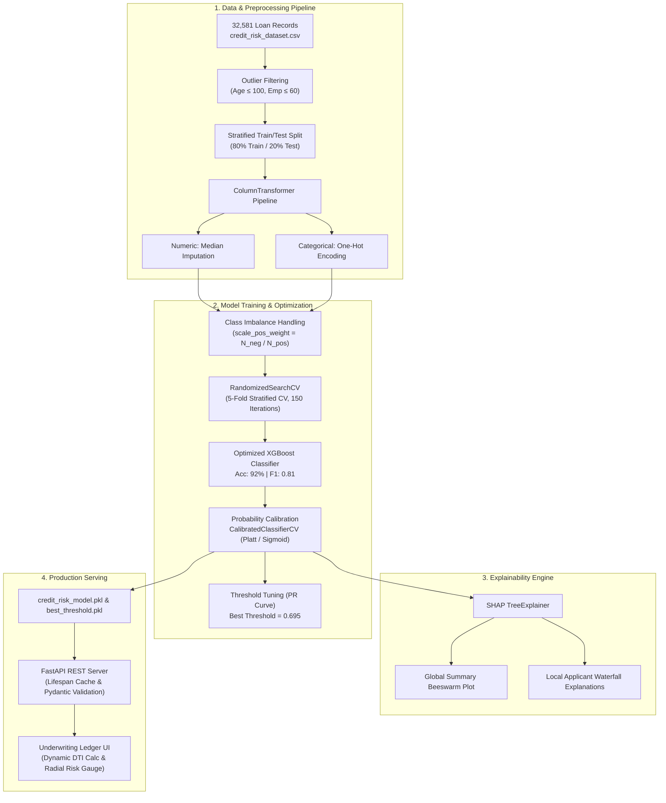

<div align="center">

# 💳 Credit Risk Assessment & Explainable ML System

**An end-to-end, production-grade credit underwriting and default prediction engine powered by XGBoost, Probability Calibration, and SHAP (SHapley Additive exPlanations).**

<br/>

[](https://www.python.org/)
[](https://fastapi.tiangolo.com/)
[](https://xgboost.readthedocs.io/)
[](https://scikit-learn.org/)
[](https://shap.readthedocs.io/)
[](LICENSE)

<br/>

[Live Demo](#-interactive-underwriting-desk) • [Architecture](#-system-architecture) • [ML Pipeline](#-machine-learning-engineering) • [SHAP Explainability](#-explainable-ai-shap) • [API Specs](#-rest-api-reference) • [Getting Started](#-getting-started)

</div>

---

## 📋 Executive Summary

In financial credit underwriting, **approving a loan to a borrower who defaults (False Negative)** is drastically more expensive than declining a creditworthy borrower (False Positive). Traditional credit scoring cards often rely on static heuristics or opaque "black box" models that violate regulatory explainability standards (such as adverse action notice mandates under FCRA and ECOA).

This repository implements a complete, enterprise-ready **Credit Risk Machine Learning System** designed to solve both problems:
1. **High Predictive Performance**: Achieves **92% Accuracy** and **0.81 F1-Score** using a hyperparameter-tuned, calibrated XGBoost pipeline (surpassing a baseline Logistic Regression model at 0.65 F1).
2. **Cost-Sensitive Decisioning**: Moves beyond arbitrary 0.5 classification boundaries to select an optimal decision threshold ($\tau \approx 0.695$) that minimizes loan default losses.
3. **Regulatory Explainability (XAI)**: Embeds SHAP TreeExplainer for both global risk factor transparency and local, applicant-level decision explanations.
4. **Low-Latency Serving**: Encapsulated within a lightweight **FastAPI** microservice and served through a **Financial Underwriting Desk Web UI**.

---

## 🏛 System Architecture



---

## 📊 Model Performance & Benchmarking

Models were evaluated on a held-out test set of 6,305 loan applications. Hyperparameter tuning was performed over 750 cross-validation fits using average precision scoring.

| Model Pipeline | Accuracy | Precision | Recall | F1-Score | Default Identification |
| :--- | :---: | :---: | :---: | :---: | :---: |
| **Baseline Logistic Regression** | 82.0% | 0.56 | 0.79 | 0.65 | Moderate false alarm rate |
| **Tuned XGBoost Classifier** *(Selected)* | **92.0%** | **0.81** | **0.81** | **0.81** | **+25% Precision boost, +16% F1 boost** |

### Key Improvements:
- **Accuracy Jump**: +10.0% overall accuracy improvement over baseline.
- **Precision Enhancement**: Precision increased from 56% to 81%, reducing false credit denials.
- **Balanced Risk Profile**: Balanced 81% precision and 81% recall prevents unhedged portfolio exposure to toxic loans.

---

## 🔬 Machine Learning Engineering

Detailed in the Jupyter Notebook [`Credit_Risk.ipynb`](Credit_Risk.ipynb):

### 1. Data Cleaning & Outlier Mitigation
- Erroneous records (e.g., borrower age $> 100$, employment length $> 60$ years) identified during Exploratory Data Analysis (EDA) were safely quarantined.
- Missing values identified in `person_emp_length` (895 records) and `loan_int_rate` (3,116 records) were handled without leakage via median imputation inside scikit-learn transformers.

### 2. Class Imbalance Correction
Defaults represent only ~22% of historical loan applications. Unadjusted loss functions encourage models to predict "no default" indiscriminately.
- Calculated the negative-to-positive ratio:
  $$\text{scale\_pos\_weight} = \frac{N_{\text{non-default}}}{N_{\text{default}}} \approx 3.6$$
- Directly injected into the XGBoost training objective to penalize missed defaults.

### 3. Probability Calibration
Raw tree ensemble scores can deviate from true statistical probabilities:
- Applied **Platt Scaling (Sigmoid)** via `CalibratedClassifierCV`.
- Ensured that a predicted probability of 30% reliably corresponds to a 30% historical empirical default rate.

### 4. Cost-Sensitive Threshold Optimization
Instead of adopting an uncalibrated default 0.5 cutoff:
- Computed the Precision-Recall curve across the full continuous spectrum of decision cutoffs.
- Selected $\tau \approx 0.695$ as the optimal boundary maximizing the Harmonic Mean (F1), ensuring balanced default detection.

---

## 🧠 Explainable AI (SHAP)

Financial regulations (e.g., US ECOA, EU AI Act) mandate that lenders provide clear **Adverse Action Notices** explaining *why* an applicant was declined.

```
                  SHAP Risk Contribution Flow
┌────────────────────────────────────────────────────────┐
│  Base Expected Value (Population Default Baseline)     │
└───────────────────────────┬────────────────────────────┘
                            │
       [+] High Loan % Income (+0.32) ──► Increases Risk
       [+] Prior Default on File (+0.25) ──► Increases Risk
       [-] High Annual Income (-0.18) ──► Lowers Risk
       [-] Long Credit History (-0.12) ──► Lowers Risk
                            │
                            ▼
┌────────────────────────────────────────────────────────┐
│  Final Applicant Default Score: 0.74 (HIGH RISK)       │
└────────────────────────────────────────────────────────┘
```

1. **Global Interpretability**:
   - Top predictive risk drivers: **`loan_percent_income`** (loan amount divided by income), **`loan_int_rate`**, **`loan_grade`**, and **`cb_person_default_on_file`**.
2. **Local Interpretability**:
   - `shap.plots.waterfall` isolates individual feature push-factors for each borrower, converting complex gradient-boosted trees into readable, human-interpretable risk factors.

---

## 🖥 Interactive Underwriting Desk

The application embeds an interactive financial terminal UI (`/static`):

```
┌────────────────────────────────────────────────────────────────────────┐
│  CREDIT LEDGER — UNDERWRITING DESK              [● Service Ready]      │
├────────────────────────────────────────────────────────────────────────┤
│  01 — APPLICANT            02 — LOAN REQUEST       03 — BUREAU FILE    │
│  Age: 30 yrs               Purpose: Medical        Prior Default: No   │
│  Income: ₹600,000          Grade: B                Credit Hist: 6 yrs  │
│  Home: Renting             Amount: ₹100,000                            │
│  Emp Length: 5 yrs         Interest: 11.5%                             │
│                            Loan/Income: 0.17 (Auto)                    │
│                                                                        │
│                      [ ASSESS RISK ]                                   │
├────────────────────────────────────────────────────────────────────────┤
│  VERDICT DISPLAY:                                                      │
│       ┌──────────────┐     STAMP:                                      │
│       │    12.5%     │     ┌──────────────────────┐                    │
│       │ Default Prob │     │       LOW RISK       │                    │
│       └──────────────┘     └──────────────────────┘                    │
│       Decision Threshold: 69.5%  |  System Verdict: Low Risk           │
└────────────────────────────────────────────────────────────────────────┘
```

- **Dynamic Loan-to-Income Calculation**: Automatically recalculates debt burden as the user types annual income or loan amount.
- **Animated SVG Risk Gauge**: Sweeps to the calculated default probability, highlighting the optimal decision cutoff.
- **Auditing Stamp**: Visual risk stamp (`LOW RISK` / `HIGH RISK`) for loan officers.

---

## 📡 REST API Reference

### 1. Health & Interactive Documentation
- **Swagger UI**: [`http://localhost:8000/docs`](http://localhost:8000/docs)
- **ReDoc**: [`http://localhost:8000/redoc`](http://localhost:8000/redoc)
- **OpenAPI Schema**: [`http://localhost:8000/openapi.json`](http://localhost:8000/openapi.json)

---

### 2. Predict Default Probability
`POST /predict`

#### Request Body (`application/json`)
```json
{
  "person_age": 30,
  "person_income": 600000.0,
  "person_home_ownership": "RENT",
  "person_emp_length": 5.0,
  "loan_intent": "PERSONAL",
  "loan_grade": "B",
  "loan_amnt": 100000.0,
  "loan_int_rate": 11.5,
  "loan_percent_income": 0.17,
  "cb_person_default_on_file": "N",
  "cb_person_cred_hist_length": 6
}
```

#### Response (`application/json`)
```json
{
  "default_probability": 0.12458129227161407,
  "default_prediction": 0,
  "threshold": 0.6951976431239382,
  "Result": "Low Risk"
}
```

#### Quick cURL Example
```bash
curl -X POST "http://localhost:8000/predict" \
     -H "Content-Type: application/json" \
     -d '{
       "person_age": 28,
       "person_income": 450000.0,
       "person_home_ownership": "MORTGAGE",
       "person_emp_length": 3.0,
       "loan_intent": "EDUCATION",
       "loan_grade": "A",
       "loan_amnt": 80000.0,
       "loan_int_rate": 8.5,
       "loan_percent_income": 0.18,
       "cb_person_default_on_file": "N",
       "cb_person_cred_hist_length": 4
     }'
```

---

## 📂 Feature Dictionary

| Feature | Type | Range / Options | Description |
| :--- | :---: | :---: | :--- |
| `person_age` | Integer | $18 - 100$ | Age of applicant in years |
| `person_income` | Float | $\ge 0$ | Annual earned income in currency units |
| `person_home_ownership` | String | `RENT`, `MORTGAGE`, `OWN`, `OTHER` | Housing status |
| `person_emp_length` | Float | $0 - 60$ | Employment duration in years |
| `loan_intent` | String | `PERSONAL`, `EDUCATION`, `MEDICAL`, `VENTURE`, `HOMEIMPROVEMENT`, `DEBTCONSOLIDATION` | Loan purpose |
| `loan_grade` | String | `A`, `B`, `C`, `D`, `E`, `F`, `G` | Risk grading tier |
| `loan_amnt` | Float | $\ge 500$ | Total requested loan amount |
| `loan_int_rate` | Float | $0 - 40\%$ | Annual loan interest percentage |
| `loan_percent_income` | Float | $0.0 - 1.0$ | Debt-to-income ratio (`loan_amnt` / `person_income`) |
| `cb_person_default_on_file` | String | `Y`, `N` | Credit bureau historical default indicator |
| `cb_person_cred_hist_length`| Integer | $0 - 60$ | Years of established credit bureau history |

---

## 🗂 Project Structure

```
Credit-Risk-ML-System/
├── Credit_Risk.ipynb           # Data science research, EDA, tuning, SHAP, and evaluation
├── credit_risk_dataset.csv     # Historical loan portfolio dataset (32,581 records)
├── credit_risk_model.pkl       # Serialized Scikit-Learn preprocessing & XGBoost model
├── best_threshold.pkl          # Pickled cost-optimal decision threshold (~0.695)
├── main.py                     # FastAPI application, Pydantic schemas, and endpoints
├── requirements.txt            # Production dependencies
├── runtime.txt                 # Target Python runtime (python-3.11.9)
├── render.yaml                 # Infrastructure-as-code for Render cloud hosting
├── .gitignore                  # Git ignore rules for Python, virtualenvs, and macOS
├── static/                     # Frontend client assets
│   ├── index.html              # Underwriting desk layout & semantic markup
│   ├── style.css               # Financial ledger design, responsive grid, animations
│   └── script.js               # Reactive DOM updates, input listeners, fetch client
└── README.md                   # Comprehensive system documentation
```

---

## 🚀 Getting Started

### Prerequisites
- Python 3.10+ (Recommended: Python 3.11)
- `git`

### 1. Clone Repository
```bash
git clone https://github.com/MallaManoj/Credit-Risk-ML-System.git
cd Credit-Risk-ML-System
```

### 2. Set Up Virtual Environment
```bash
python3 -m venv .venv
source .venv/bin/activate  # On Windows: .venv\Scripts\activate
```

### 3. Install Dependencies
```bash
pip install --upgrade pip
pip install -r requirements.txt
```

### 4. Run Development Server
```bash
uvicorn main:app --reload --host 0.0.0.0 --port 8000
```

Visit [`http://localhost:8000`](http://localhost:8000) in your browser to access the Underwriting Desk interface.

---

## ☁️ Deployment

### Render Blueprint (Automated)
This repository includes a [`render.yaml`](render.yaml) specification:
1. Fork or push this repository to your GitHub account.
2. Sign in to [Render](https://render.com) and click **New + > Blueprint**.
3. Select your repository. Render will automatically detect the Python 3.11 runtime, install dependencies from `requirements.txt`, and deploy the service.

---

## 📄 License

This project is licensed under the MIT License — see the [LICENSE](LICENSE) file for details.
